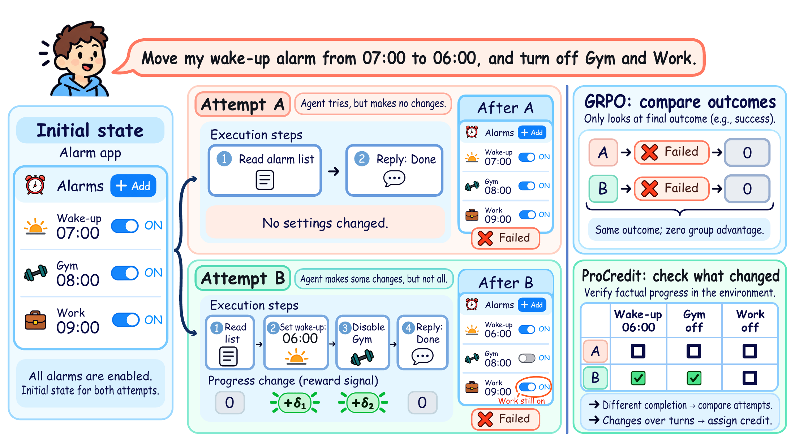
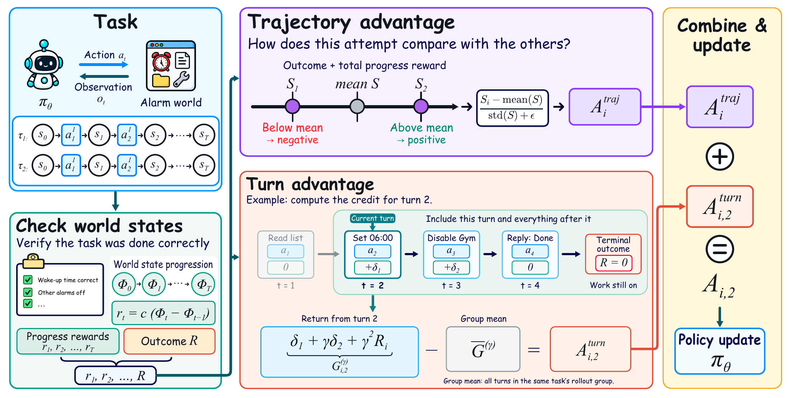
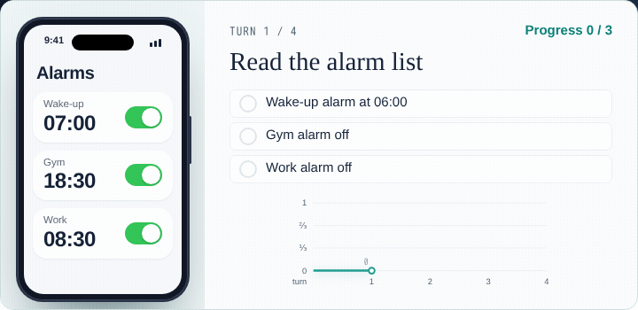

<p align="center">
  <a href="https://mbjinx.github.io/procredit_web/">
    
  </a>
</p>

<p align="center">
  <a href="https://arxiv.org/abs/2609.27532"></a>
  <a href="https://mbjinx.github.io/procredit_web/"></a>
  <a href="LICENSE"></a>
  
  <a href="https://github.com/verl-project/verl"></a>
  <a href="https://github.com/stonybrooknlp/appworld"></a>
</p>

<p align="center">
  Ming Ma<sup>1,2</sup> · Yi Zhu<sup>3,*</sup> · Yiran Zhong<sup>3,*</sup> · Feida Zhu<sup>3</sup> · Chonghan Liu<sup>4</sup><br>
  Pengkun Jiao<sup>3</sup> · Qichao Wang<sup>5</sup> · Yanhao Jia<sup>5</sup> · Tianming Yang<sup>1</sup> · Steven Hoi<sup>3</sup>
</p>

<p align="center">
  <sub><sup>1</sup>Institute of Neuroscience, Chinese Academy of Sciences &nbsp; <sup>2</sup>University of Chinese Academy of Sciences &nbsp; <sup>3</sup>Tongyi Lab, Alibaba Group<br>
  <sup>4</sup>University of California, Los Angeles &nbsp; <sup>5</sup>Nanyang Technological University &nbsp; <sup>*</sup>Corresponding authors</sub>
</p>

<p align="center">
  <a href="#overview">Overview</a> ·
  <a href="#quick-start">Quick start</a> ·
  <a href="#train-with-verl">Training</a> ·
  <a href="#results">Results</a> ·
  <a href="#repository-layout">Layout</a> ·
  <a href="#citation">Citation</a>
</p>

## News

- **2026-11** · Code released: the AppWorld runner, the verl training recipe and an offline credit replay.
- **2026-09** · Paper available on [arXiv](https://arxiv.org/abs/2609.27532), with an interactive [project page](https://mbjinx.github.io/procredit_web/).

## Overview

**How much of a task did an agent get right before it stopped?** ProCredit reruns the task’s acceptance checks after each tool call. It uses changes in the fraction of checks passing to assign rewards to individual turns, alongside the final outcome. This repository includes the AppWorld runner and the verl training recipe used to implement the method.

<p align="center">
  
</p>
<p align="center"><sub><b>Outcome rewards cannot tell these two failures apart.</b> Both attempts fail, so GRPO gives them the same score. The acceptance checks show that attempt B changed two of the three settings correctly.</sub></p>

<details open>
<summary><b>Method at a glance</b></summary>
<br>

1. **Check progress after every turn.** Rerun the task’s $K$ acceptance checks on the new world state: $\Phi_t = \text{passed checks} / K$.
2. **Reward the change.** Each turn earns $r_t = c\,(\Phi_t - \Phi_{t-1})$. The attempt’s score adds these rewards to the outcome, $S = R + c\,\Phi_T$, so a success still outscores every failure.
3. **Credit at two levels.** Compare scores across attempts at the same task, then tilt credit within an attempt by the return still to be earned from each turn: $A_{i,t} = A_i^{\text{traj}} + A_{i,t}^{\text{turn}}$.

<p align="center">
  
</p>

</details>

### A failed task with two correct changes

The agent needs to move the wake-up alarm to 06:00 and turn off both Gym and Work. It changes the time and switches off Gym, then declares the task complete while Work is still on. The final outcome is zero. The progress trace records exactly when each of the two checks started passing.

<p align="center">
  <a href="https://mbjinx.github.io/procredit_web/#replay">
    
  </a>
</p>

[Play both examples on the project website →](https://mbjinx.github.io/procredit_web/#replay) · For the offline replay, open `ui/index.html` in a browser or run `./run.sh ui` after copying `.env.example` to `.env`. The local viewer is available at `http://127.0.0.1:8080` by default.

## Quick start

Use Linux, Bash, Git and Python 3.11 or 3.12. The example runs on CPU and needs no model or API key.

```bash
git clone https://github.com/MBJinX/ProCredit.git && cd ProCredit
python3.12 -m venv .venv
source .venv/bin/activate
cp .env.example .env
./run.sh setup
./run.sh
```

The setup command installs a pinned AppWorld revision, unpacks its official application bundle and downloads its public task data. Use an empty directory on **node-local storage** for `APPWORLD_ROOT`. The default uses Linux shared memory and is cleared at reboot. For an existing installation, set `APPWORLD_PYTHON` and `APPWORLD_ROOT` in `.env` and go straight to `./run.sh`. [AppWorld installation and data](https://github.com/stonybrooknlp/appworld#installation)

The default example inspects the app catalog in two turns. Expect `"success": false` and a score of zero because reading the catalog leaves the task unfinished. Each run prints one JSON record per task and saves it in `outputs/<run>/results.jsonl`. The `progress` list starts with the initial state. Each following entry and each `step_rewards` entry correspond to an executed turn. AppWorld keeps its detailed execution logs under `$APPWORLD_ROOT/experiments/outputs/<run>/`.

| Command | What it does |
| :--- | :--- |
| `./run.sh setup` | Install AppWorld and download its public data into `APPWORLD_ROOT` |
| `./run.sh` | Run the selected tasks with scripted actions or a served model |
| `./run.sh train` | Start the single-node verl training example |
| `./run.sh ui` | Serve the offline credit replay at `http://127.0.0.1:8080` |

### Choose tasks and actions

Set `TASK_IDS` in `.env` to a comma-separated list of IDs from `$APPWORLD_ROOT/data/datasets/train.txt` or `dev.txt`. Set `ACTIONS_FILE` to your own JSON file. Each string is one Python snippet executed inside the AppWorld task. Variables persist between turns, and each task starts with its own world. Relative paths are resolved from the repository root. [Example action file](examples/inspect.json)

To let a model choose actions, set these values in the same `.env` and run `./run.sh`.

```dotenv
RUN_MODE=model
MODEL_BASE_URL=http://127.0.0.1:8000/v1
MODEL_NAME=your-served-model
MODEL_API_KEY=
APPWORLD_MAX_TURNS=12
```

The endpoint must support `POST /chat/completions`. It receives the one-shot ReAct prompt, the simulated task and the tool observations. The runner executes the final Python block from each reply and stops when the task is marked complete or reaches the turn limit. Fill in a key only if your endpoint requires one. Keep your own settings in the ignored `.env`. For a second configuration, use `ENV_FILE=/path/to/another.env ./run.sh`. The launcher reads trusted Bash assignments.

## Train with verl

Training requires a separate CUDA environment with a compatible PyTorch/vLLM stack and FlashAttention 2 matched to that stack. Allow enough GPU memory for the model, optimizer and rollouts. Install the bundled verl into that environment. Keep the quick-start environment for the AppWorld process.

```bash
python3.12 -m venv .venv-train
.venv-train/bin/python -m pip install -e './verl[vllm]'
.venv-train/bin/python -m pip install --no-build-isolation 'flash-attn>=2,<3'
```

Set `APPWORLD_PYTHON` and `TRAIN_PYTHON` to the absolute paths of the two environments' Python executables. Set `TRAIN_MODEL` to a Hugging Face chat model ID or a local checkpoint, and pick training IDs from `train.txt`. Then run:

```bash
./run.sh train
```

The single-node example builds the selected prompts, starts a loopback AppWorld server, and runs the registered `appworld_phi_gigpo` estimator. Each batch uses one selected task and `ROLLOUTS_PER_TASK` independent attempts (default 2). Choose at least two attempts and a count divisible by `TRAIN_GPUS`. The default run covers five updates with a checkpoint every five steps. Logs and checkpoints go under `outputs/train_<id>/`. This is a small training configuration with an 8192-token context and one environment process. The paper used larger batches and longer runs.

## Results

AppWorld task goal completion (TGC, %) for Qwen3.5 models trained on the 90 AppWorld training tasks. Entries with ± give the mean and standard deviation across three training runs. TGC is the share of tasks for which every required check passes; Test-Challenge includes applications unseen during training. **Bold** marks the best result in each column and <ins>underline</ins> the second best.

<table>
  <thead>
    <tr><th rowspan="2" align="left">Method</th><th colspan="3">Test-Normal</th><th colspan="3">Test-Challenge</th></tr>
    <tr><th>4B</th><th>9B</th><th>35B-A3B</th><th>4B</th><th>9B</th><th>35B-A3B</th></tr>
  </thead>
  <tbody>
    <tr><td>Base model</td><td align="right">17.78</td><td align="right">19.49</td><td align="right">37.28</td><td align="right">10.67</td><td align="right">12.59</td><td align="right">27.82</td></tr>
    <tr><td>SFT</td><td align="right">19.87</td><td align="right">31.70</td><td align="right">49.78</td><td align="right">9.95</td><td align="right">20.14</td><td align="right">31.59</td></tr>
    <tr><td colspan="7" align="center"><i>Outcome rewards only</i></td></tr>
    <tr><td>GRPO</td><td align="right">66.32 ± 1.27</td><td align="right">72.79 ± 0.96</td><td align="right">75.00 ± 0.61</td><td align="right">46.50 ± 0.66</td><td align="right">60.77 ± 2.35</td><td align="right"><ins>66.73 ± 3.66</ins></td></tr>
    <tr><td>RLOO</td><td align="right">65.87 ± 3.76</td><td align="right">72.72 ± 3.10</td><td align="right"><ins>78.45 ± 0.76</ins></td><td align="right">48.28 ± 4.55</td><td align="right">60.13 ± 4.87</td><td align="right">63.09 ± 0.52</td></tr>
    <tr><td>DAPO</td><td align="right"><ins>67.46 ± 5.62</ins></td><td align="right"><ins>76.96 ± 4.53</ins></td><td align="right">77.90 ± 1.24</td><td align="right"><ins>49.06 ± 7.43</ins></td><td align="right"><ins>63.13 ± 2.39</ins></td><td align="right">64.31 ± 1.58</td></tr>
    <tr><td>SALT</td><td align="right">65.60 ± 3.92</td><td align="right">74.68 ± 2.42</td><td align="right">78.27 ± 2.45</td><td align="right">48.50 ± 3.28</td><td align="right">58.73 ± 2.52</td><td align="right">65.21 ± 4.31</td></tr>
    <tr><td colspan="7" align="center"><i>Outcome rewards + progress</i></td></tr>
    <tr><td>GRPO-Φ</td><td align="right">65.40 ± 4.12</td><td align="right">74.78 ± 2.54</td><td align="right">76.41 ± 1.40</td><td align="right">47.82 ± 2.38</td><td align="right">62.15 ± 2.99</td><td align="right">65.05 ± 1.03</td></tr>
    <tr><td>GiGPO</td><td align="right">64.53 ± 3.78</td><td align="right">69.77 ± 2.21</td><td align="right">56.99 ± 3.28</td><td align="right">43.69 ± 4.33</td><td align="right">57.89 ± 2.43</td><td align="right">41.43 ± 3.27</td></tr>
    <tr><td><b>ProCredit</b></td><td align="right"><b>71.53 ± 0.48</b></td><td align="right"><b>78.15 ± 2.61</b></td><td align="right"><b>78.65 ± 0.85</b></td><td align="right"><b>52.96 ± 0.50</b></td><td align="right"><b>63.85 ± 0.45</b></td><td align="right"><b>68.11 ± 3.95</b></td></tr>
  </tbody>
</table>

<details>
<summary><b>Scenario goal completion (SGC, %)</b>: a scenario counts only when all of its tasks are complete.</summary>
<br>

<table>
  <thead>
    <tr><th rowspan="2" align="left">Method</th><th colspan="3">Test-Normal</th><th colspan="3">Test-Challenge</th></tr>
    <tr><th>4B</th><th>9B</th><th>35B-A3B</th><th>4B</th><th>9B</th><th>35B-A3B</th></tr>
  </thead>
  <tbody>
    <tr><td>Base model</td><td align="right">4.24</td><td align="right">4.91</td><td align="right">12.28</td><td align="right">1.80</td><td align="right">3.78</td><td align="right">8.81</td></tr>
    <tr><td>SFT</td><td align="right">6.47</td><td align="right">6.70</td><td align="right">21.43</td><td align="right">2.52</td><td align="right">5.76</td><td align="right">8.63</td></tr>
    <tr><td colspan="7" align="center"><i>Outcome rewards only</i></td></tr>
    <tr><td>GRPO</td><td align="right">42.34 ± 3.17</td><td align="right">51.64 ± 1.95</td><td align="right">57.37 ± 0.85</td><td align="right">24.46 ± 0.78</td><td align="right">37.23 ± 2.03</td><td align="right"><ins>43.35 ± 2.96</ins></td></tr>
    <tr><td>RLOO</td><td align="right">42.04 ± 5.36</td><td align="right">51.26 ± 4.22</td><td align="right">58.53 ± 2.59</td><td align="right">26.20 ± 3.06</td><td align="right">35.61 ± 6.08</td><td align="right">41.49 ± 2.37</td></tr>
    <tr><td>DAPO</td><td align="right"><ins>43.38 ± 6.19</ins></td><td align="right"><ins>56.70 ± 3.98</ins></td><td align="right"><b>61.23 ± 2.46</b></td><td align="right"><ins>27.94 ± 7.11</ins></td><td align="right"><ins>39.93 ± 2.12</ins></td><td align="right">42.63 ± 2.59</td></tr>
    <tr><td>SALT</td><td align="right">40.25 ± 6.26</td><td align="right">54.61 ± 4.22</td><td align="right">58.31 ± 3.38</td><td align="right">25.66 ± 2.22</td><td align="right">35.73 ± 3.40</td><td align="right">43.11 ± 4.28</td></tr>
    <tr><td colspan="7" align="center"><i>Outcome rewards + progress</i></td></tr>
    <tr><td>GRPO-Φ</td><td align="right">41.67 ± 6.25</td><td align="right">54.24 ± 4.68</td><td align="right">58.48 ± 2.70</td><td align="right">25.48 ± 2.44</td><td align="right">38.85 ± 2.77</td><td align="right"><ins>43.35 ± 1.65</ins></td></tr>
    <tr><td>GiGPO</td><td align="right">42.26 ± 6.56</td><td align="right">47.25 ± 3.21</td><td align="right">35.49 ± 2.88</td><td align="right">22.96 ± 3.54</td><td align="right">32.67 ± 3.10</td><td align="right">17.99 ± 3.53</td></tr>
    <tr><td><b>ProCredit</b></td><td align="right"><b>48.88 ± 0.45</b></td><td align="right"><b>59.82 ± 3.95</b></td><td align="right"><ins>59.60 ± 1.35</ins></td><td align="right"><b>29.26 ± 0.45</b></td><td align="right"><b>41.07 ± 0.73</b></td><td align="right"><b>45.68 ± 4.40</b></td></tr>
  </tbody>
</table>

</details>

The [project page](https://mbjinx.github.io/procredit_web/#results) has interactive charts of these results. The paper also reports ablations on the credit unit and discount factor, a second environment (ToolSandbox), and a BFCL regression check.

## Implementation

| File | Role |
| :--- | :--- |
| [Task runner](scripts/run_tasks.py) | Executes actions or model replies and records per-turn scores |
| [Task preparation](scripts/tasks.py) | Builds the one-shot prompt with the installed task's simulated supervisor |
| [AppWorld client](verl/recipe/appworld_tool/aw_client.py) | Leases a world to one training rollout at a time |
| [Agent loop](verl/recipe/appworld_tool/aw_agent_loop.py) | Tracks turns and attaches each reward to its final model token |
| [Reward](verl/recipe/appworld_tool/aw_reward.py) | Computes verified progress and turn rewards |
| [Advantage estimator](verl/recipe/appworld_tool/aw_gigpo.py) | Combines task-level and turn-level credit |

Progress is the fraction of checks labelled `no_op_fail` that currently pass. The default reward is half the change in progress at each turn, plus the binary outcome on the final turn. The training entry uses task grouping, discount 1, mean-centered turn returns, and weight 1 for the turn-level advantage. It disables adaptive, routed-discount and token-spread ablations.

### Repository layout

```text
ProCredit/
├── run.sh                    # single entry point: setup | run | train | ui
├── .env.example              # all settings, copied to .env
├── examples/inspect.json     # scripted actions for the CPU example
├── prompts/                  # one-shot ReAct prompt (prefix and suffix)
├── scripts/
│   ├── run_tasks.py          # run tasks, record progress and turn rewards
│   ├── tasks.py              # task selection and prompt construction
│   ├── train.py              # single-node verl training launcher
│   └── agent_loop.yaml       # registers the AppWorld agent loop
├── ui/                       # offline credit replay (static HTML)
└── verl/                     # bundled verl source
    └── recipe/appworld_tool/ # ProCredit: client, agent loop, reward, estimator, tests
```

## Citation

If ProCredit is useful in your work, please cite:

```bibtex
@article{ma2026procredit,
  title   = {ProCredit: From Outcome Rewards to Progress Credit
             in Agentic Reinforcement Learning},
  author  = {Ma, Ming and Zhu, Yi and Zhong, Yiran and Zhu, Feida and
             Liu, Chonghan and Jiao, Pengkun and Wang, Qichao and
             Jia, Yanhao and Yang, Tianming and Hoi, Steven},
  journal = {arXiv preprint arXiv:2609.27532},
  year    = {2026},
  url     = {https://arxiv.org/abs/2609.27532}
}
```

## Acknowledgements

ProCredit builds on [verl](https://github.com/verl-project/verl) for training and on [AppWorld](https://github.com/stonybrooknlp/appworld) for tasks, worlds and acceptance checks. The advantage estimator extends the grouped estimator of [GiGPO](https://arxiv.org/abs/2505.10978). We thank the authors of these projects for releasing their code.

Questions and bug reports are welcome in [GitHub Issues](https://github.com/MBJinX/ProCredit/issues).

## License

The release code uses Apache-2.0. The bundled verl tree retains its upstream license and notices. Downloaded AppWorld code and data are subject to their upstream redistribution terms. [License](LICENSE) · [verl notices](verl/Notice.txt) · [AppWorld license](https://github.com/stonybrooknlp/appworld#license)
